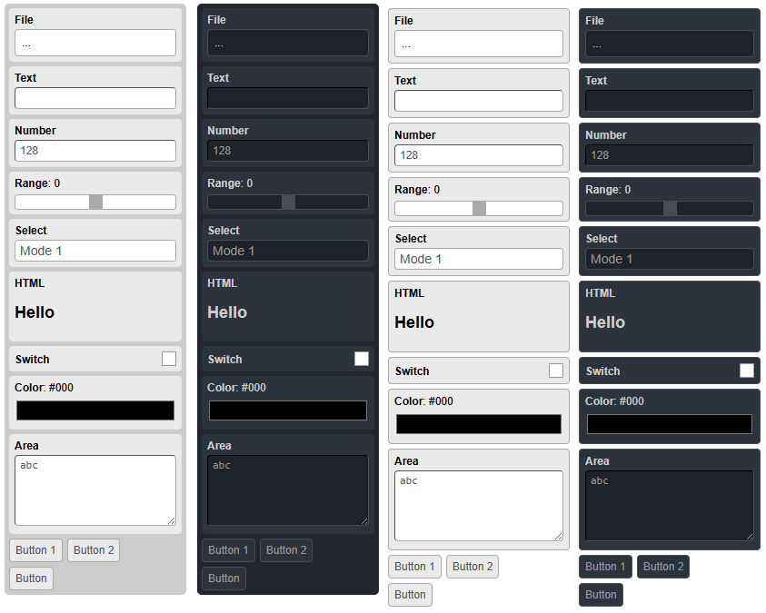

# UI.js

Конструктор для создания простого меню настроек в браузере

[Демо](https://gyverlibs.github.io/UI.js/test/)



**Browser:** https://gyverlibs.github.io/UI.js/UI.min.js  
**Node:** `npm i @alexgyver/ui`

## Быстрый старт

```js
const ui = new UI({ title: 'Control', theme: 'dark' });

ui.addSlider('speed', 'Speed', 50, 0, 100, 1, v => console.log(v));
ui.addSwitch('enabled', 'Enabled', true);
ui.addProgress('load', 'Load', 25);

ui.speed = 75;
ui.set('load', 60);
console.log(ui.get('speed'));
```

В сборке для браузера используется глобальный `UI`. При использовании пакета импортируй класс из `@alexgyver/ui` согласно формату сборки проекта.

## Методы UI

```js
// настройки панели
setTheme(theme);                  // 'dark', 'light', 'dark noback', 'light noback'
setCursor(index);                 // позиция вставки следующего виджета
resetCursor();                    // сброс позиции вставки
useWheel(use);                    // колесо мыши для Number, Slider и Select
setLabels(labels);                // установить подписи из объекта { id: label }
onChange(callback);               // общий обработчик (id, value, text)

// значения и виджеты
get(idOrIndex);
set(idOrIndex, value);
widget(idOrIndex);
widgets(idsOrIndexes);
count();
toObject(ids = null);
toJson();
fromObject(data);
fromJson(json);

// удаление
remove(ids);                     // id, индекс или массив id/индексов
removeAll();
destroy();

// виджеты
addSwitch(id, label, value, callback);
addNumber(id, label, value, step, callback);
addText(id, label, value, callback);
addInput(id, label, value, callback); // псевдоним addText
addSlider(id, label, value, min, max, step, callback);
addRange(id, label, value, min, max, step, callback); // псевдоним addSlider
addProgress(id, label, value = 0, min = 0, max = 100);
addJoystick(id, label, returnCenter = true, callback);
addArea(id, label, value, callback, rows = 5);
addHTML(id, label, value);
addElement(id, label, value);
addSelect(id, label, options, callback);
addFile(id, label, callback);
addColor(id, label, value, callback);
addLabel(id, label, value);
addSpace(height = 5);
addButton(id, label, callback);
addButtons(buttons);             // { id: [label, callback] } или { id: label }

// группы
addGroup(id, label, callback, expanded = false);
beginGroup(id, label, expanded = false);
endGroup();
```

`setCursor()` задаёт позицию вставки новых элементов, `resetCursor()` возвращает добавление в конец. Методы `addXxx()` возвращают экземпляр `UI`, поэтому их можно вызывать цепочкой.

Если `id` не задан или передана пустая строка, создаётся автоматический ID. При включённом `autoVar` (по умолчанию) значение виджета доступно также как свойство `ui.id`. Для `Select` создаётся геттер `ui.idText`, для `Color` - геттер и сеттер `ui.idInt`.

Программное изменение через `ui.set()`, `ui.id` или `widget.value` обновляет интерфейс, но не вызывает обработчик изменения. События пользовательского ввода передаются в общий `onChange()` и в callback конкретного виджета. Для `Select` дополнительно передаётся текст выбранного варианта.

## Методы виджета

Объект виджета доступен через `ui.widget(id)`:

```js
const w = ui.widget('speed');

w.type;            // тип
w.label;           // подпись, можно изменять
w.value;           // значение, можно изменять
w.input;           // элемент ввода, если предусмотрен
w.container;       // корневой HTMLElement
w.call();          // вызвать локальный callback
w.display(true);   // показать или скрыть
w.show();
w.hide();
w.default();       // восстановить начальное значение
```

Для удаления виджета вместе с регистрацией в UI используй `ui.remove(id)`, а не `widget.remove()`.

Дополнительные свойства и методы:

```js
// Select
w.options;         // массив подписей, доступен для записи
w.valueText;       // текст выбранного варианта
w.text;            // псевдоним valueText
w.reset();         // выбрать первый вариант

// Color
w.valueInt;        // числовой цвет 0x000000...0xffffff, чтение и запись

// Group
w.expanded;        // состояние раскрытия, чтение и запись
w.open();
w.close();
w.toggle();
```

## Группы
Через callback:

```js
ui.addGroup('motor', 'Motor', ui => {
    ui.addSlider('speed', 'Speed', 50, 0, 100, 1);
    ui.addSwitch('enabled', 'Enabled', true);
});
```

Потоковое создание:

```js
ui.beginGroup('sensors', 'Sensors', false);
ui.addProgress('temperature', 'Temperature', 25, 0, 100);
ui.addProgress('battery', 'Battery', 80, 0, 100);
ui.endGroup();

ui.addButton('reset', 'Reset', () => ui.widget('sensors').open());
```

При удалении группы через `ui.remove('sensors')` удаляются все зарегистрированные в ней виджеты. Ручное скрытие отдельного виджета сохраняется при сворачивании и раскрытии группы. Группы не имеют пользовательского значения и не предназначены для экспорта как параметры настроек.

## Сохранение настроек

```js
const data = ui.toObject();
const json = ui.toJson();

ui.fromObject(data);
ui.fromJson(json);

ui.setLabels({ speed: 'Скорость', enabled: 'Включено' });
```

`toObject(ids)` позволяет экспортировать только указанные виджеты. Для `Select` и `Color` в объект дополнительно включаются текстовое и числовое представления с суффиксами `Text` и `Int`.
